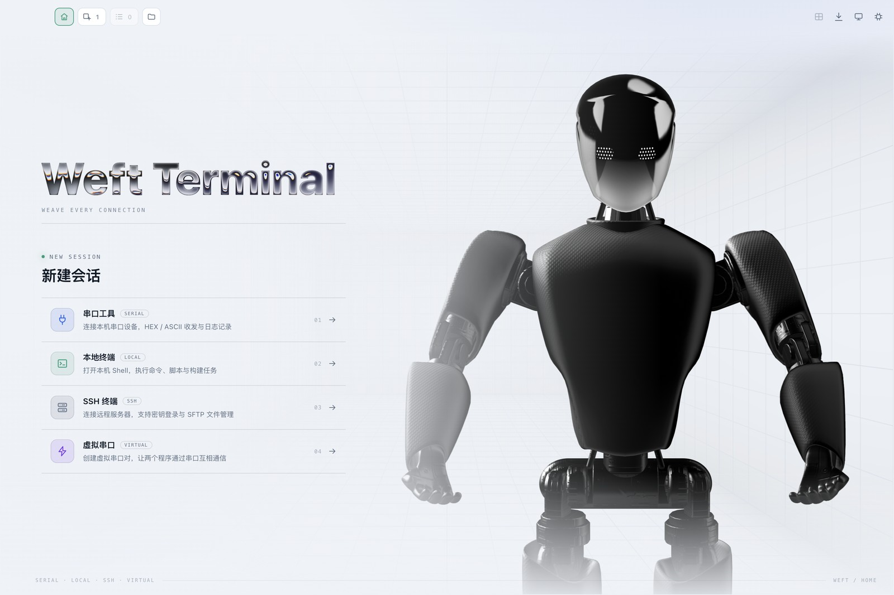
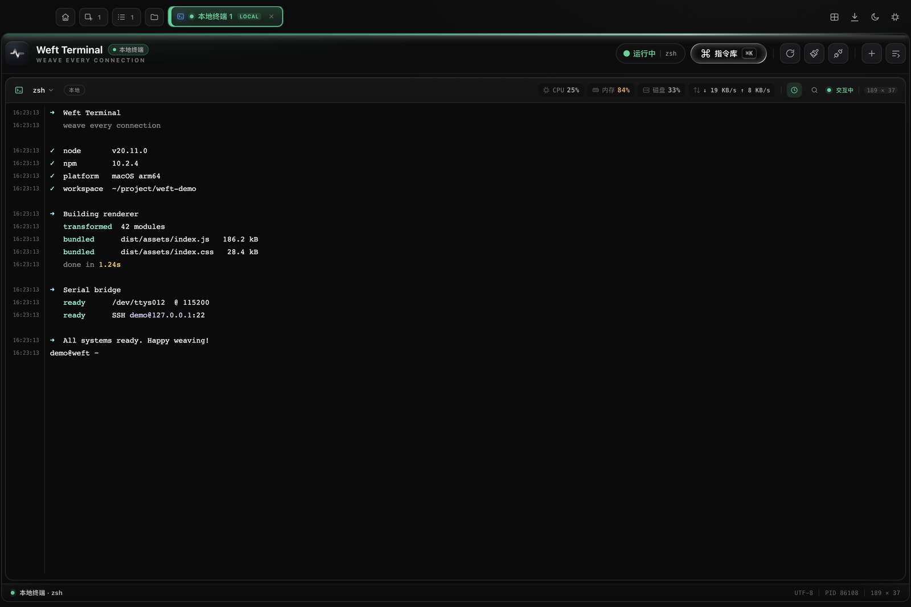
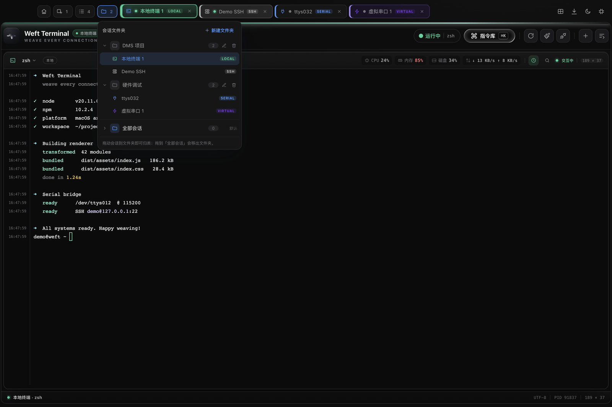
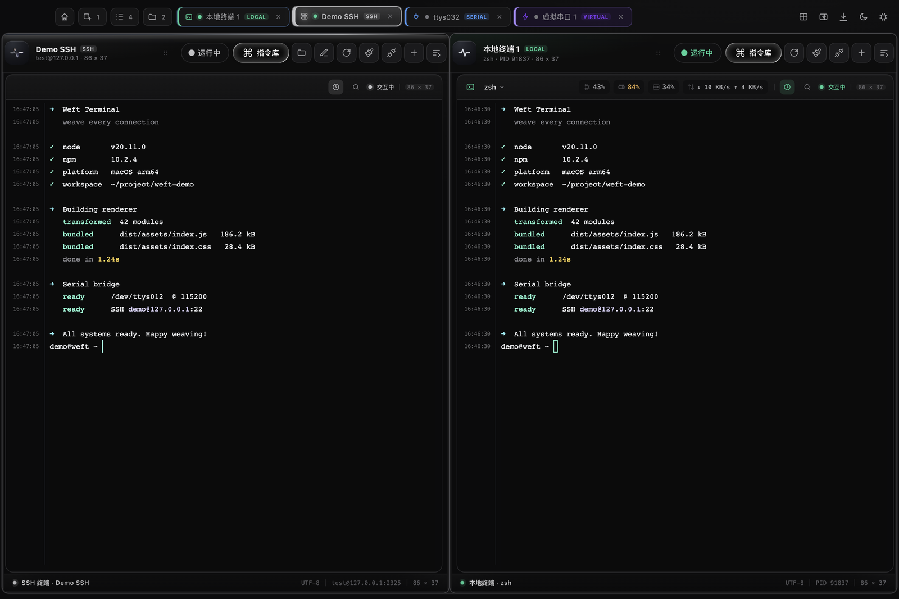
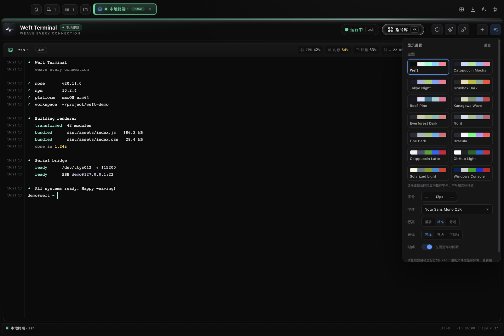
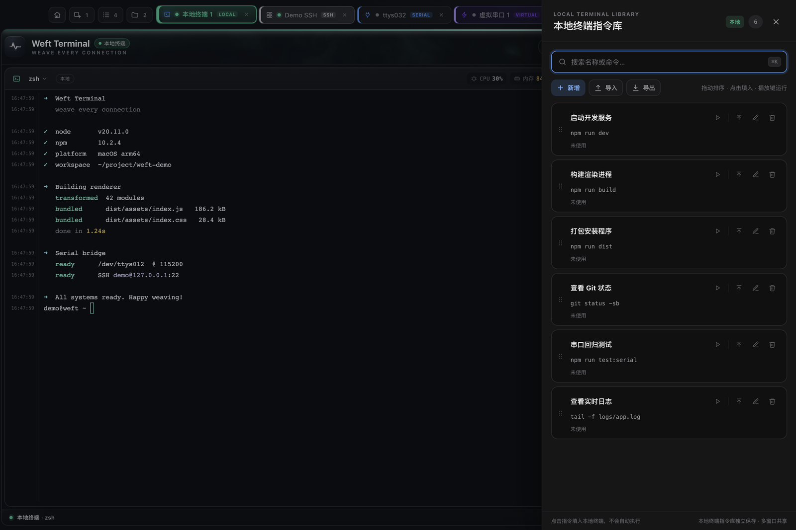

# Weft Terminal

**WEAVE EVERY CONNECTION** — 串口调试 · 本地终端 · SSH · 虚拟串口。

面向嵌入式调试、设备联调与远程运维的桌面工作台。串口、Shell、SSH 和虚拟串口共享同一套标签、文件夹与分屏布局；连接配置、日志与指令库全部保存在本机。



`macOS` · `Windows` · `Electron` · `React` · `xterm.js` · `MIT`

## 下载安装

前往 [Releases](https://github.com/910106845/Weft-Terminal/releases/latest) 下载最新版本：

- **macOS**：`.dmg` 通用安装包（Apple Silicon / Intel）。
- **Windows**：`.exe` 安装包（NSIS，支持覆盖升级）。

当前安装包未做代码签名：

- macOS 首次打开若被拦截，请右键应用选择「打开」，或执行
  `xattr -dr com.apple.quarantine "/Applications/Weft Terminal.app"`。
- Windows 若出现 SmartScreen 提示，点击「更多信息 → 仍要运行」。

应用内置更新检查：发现新版本后可在应用内直接下载并安装，macOS 安装时会请求管理员授权。

## 功能一览

| 模块 | 主要能力 |
| --- | --- |
| 串口工具 | 端口参数、HEX / ASCII / UTF-8 / GBK 收发、时间戳与行号、日志高亮与保存、指令库、循环发送、校验 |
| 本地终端 | xterm.js + WebGL 渲染、多标签、Shell 切换、搜索、时间戳、指令库、14 套主题、分屏 |
| SSH 终端 | 密码 / 私钥 / SSH Agent、主机密钥校验、编码切换、SFTP 文件管理、断线重连与输入暂存 |
| 虚拟串口 | 一个页面创建多对虚拟串口、自动回复规则、收发记录、端口与规则随页面保存 |
| 工作台 | 标签文件夹、拖拽归类、标签配色、亮 / 暗主题、2 / 3 / 4 格分屏、多窗口 |
| 数据 | 配置、日志、指令库全部保存在本机，不上传服务器 |

## 串口工具

连接参数、收发设置与接收区在同一页面完成。支持波特率、数据位、校验位、停止位、流控以及 RTS / DTR 控制；接收区可按 ASCII、UTF-8、GBK 或 HEX 显示，并叠加时间戳、行号、自动换行与日志高亮。


- 接收 / 发送可分别选择编码，中文固件日志不再乱码。
- 支持自动滚动、ANSI 颜色、日志保存和接收间隔合并，高频数据不卡界面。
- 常用指令可收藏，支持一键填入、批量发送与批量循环。
- 发送端支持尾缀自动追加（CR / LF / CRLF）、HEX 格式化，以及 XOR / CHECKSUM / CRC-8/16/32 等 40 多种校验算法。

## 本地终端

基于 xterm.js 与 WebGL 渲染，长时间输出与大量滚动仍然顺滑。可在同一窗口打开多个 Shell 标签，随时切换 `zsh` / `bash` / `fish` 等本机 Shell。



- 多标签、分屏、搜索（`⌘F` / `Ctrl+F`）、清空滚动缓冲。
- 左侧固定时间戳栏，滚动时实时对齐每一行输出。
- 指令库（`⌘K`）独立保存本地终端命令，可搜索、排序、导入导出，点击填入或直接运行。
- 14 套内置主题，可调字号、字体、行高与光标样式。
- 支持完整效果 / 性能模式切换，低配设备可关闭动态背景。

## SSH 终端

保存常用服务器，支持密码、私钥和 SSH Agent 三种认证方式，私钥口令只用于当次连接，不会写入本地配置。


- 首次连接展示主机密钥指纹，确认后写入本机 known hosts，指纹变化会拒绝连接。
- 远端输出支持 UTF-8 / GBK / GB18030 / Big5 切换，兼容老设备与中文服务器。
- 内置 SFTP 文件面板：浏览目录、上传、下载、新建文件夹、删除。
- 开启 `TCP_NODELAY` 与压缩，心跳快速发现断线；断网后按指数退避自动重连。
- 断线期间的输入会暂存，重连后填回命令行，不会静默丢失。

## 虚拟串口

一个页面可以创建多对虚拟串口，用于在没有真实硬件时联调上位机、协议解析或自动化脚本。


- macOS 使用 PTY（`/dev/ttysXXX`），Windows 依赖 [com0com](https://sourceforge.net/projects/com0com/) 生成 COM 端口对。
- 自动回复规则支持整条消息匹配，回复内容可使用 `{串口名}`、`{消息}` 模板。
- 收发记录实时展示，文本 / HEX 视图随时切换。
- 端口与规则随页面保存，关闭页面时自动释放。

## 工作台与分屏

所有会话共用一个顶部标签栏。标签按类型着色，可创建文件夹并拖拽归类；文件夹支持折叠、重命名和删除。



分屏支持左右 2 格、上下 2 格、上 1 下 2、上 2 下 1 和四宫格。每个窗格可独立操作，适合一边看串口日志、一边在终端里执行脚本。



## 终端外观

终端提供 14 套内置主题：Weft、Catppuccin Mocha、Tokyo Night、Gruvbox Dark、Rosé Pine、Kanagawa Wave、Everforest Dark、Nord、One Dark、Dracula、Catppuccin Latte、GitHub Light、Solarized Light、Windows Console。



默认使用 Weft 主题、Noto Sans Mono CJK 12px，中文与等宽字符对齐；字号、字体、行高、光标样式与时间戳均可单独调整。

## 指令库

本地终端与 SSH 终端各自维护独立的指令库，避免生产命令和本机脚本混在一起。



- 支持新增、编辑、删除、拖拽排序、搜索。
- 点击指令填入命令行，点击运行按钮直接执行。
- 支持导入 / 导出 JSON，方便团队共享常用命令。
- 本地与 SSH 指令库独立保存，多窗口共享。

## 技术栈

Electron · React 18 · Vite · xterm.js · node-pty · serialport · ssh2 · electron-updater

## 本地开发

```bash
npm install
npm run dev
```

## 构建

```bash
npm run build     # 构建渲染进程
npm start         # 构建后启动 Electron
npm run dist      # 打包安装包（macOS dmg / Windows nsis）
```

## 平台说明

- macOS 的虚拟串口是 PTY（`/dev/ttysXXX`），不会被系统串口枚举列出，需要在第三方工具里手动填写路径。
- Windows 的虚拟串口依赖 [com0com](https://sourceforge.net/projects/com0com/) 生成 COM 端口对，安装包已内置 com0com 安装程序，可在应用内直接安装。
- SSH Agent 在 macOS / Linux 读取 `SSH_AUTH_SOCK`，Windows 使用 Pageant。

## 数据目录

应用数据目录为 `Weft Terminal`（macOS 下是 `~/Library/Application Support/Weft Terminal`，Windows 下是 `%APPDATA%\Weft Terminal`）。

会话配置、指令库、主题设置与更新缓存都保存在该目录，卸载应用不会主动删除。

## License

MIT
