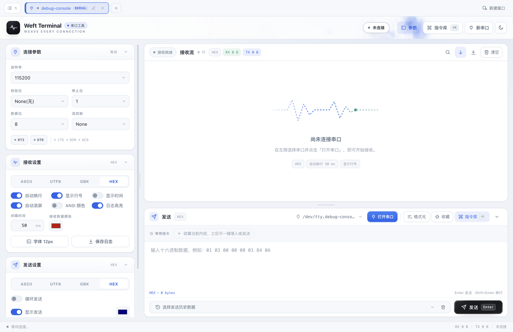
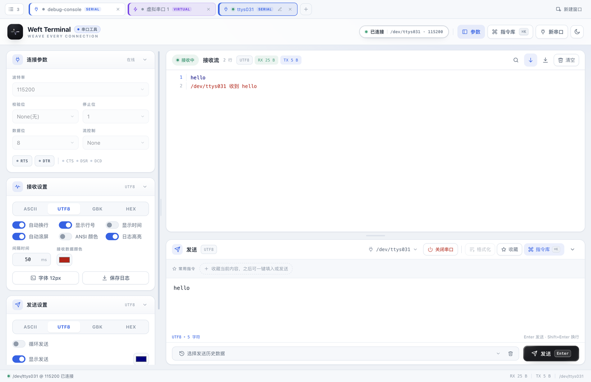
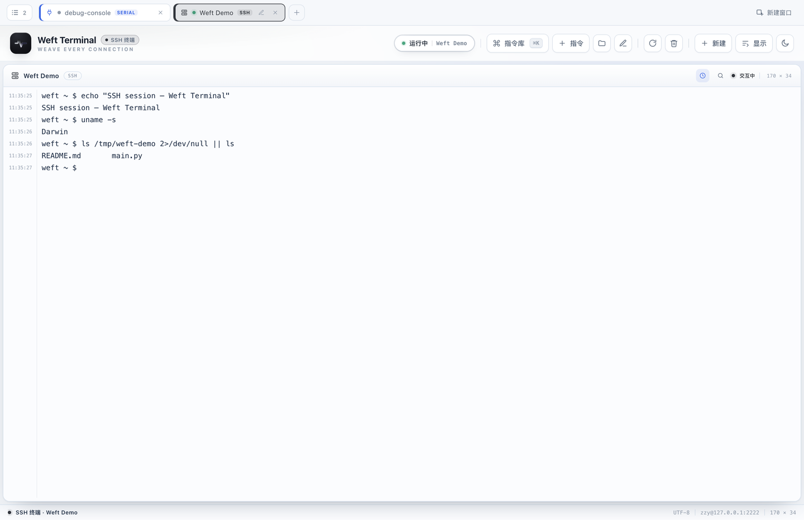
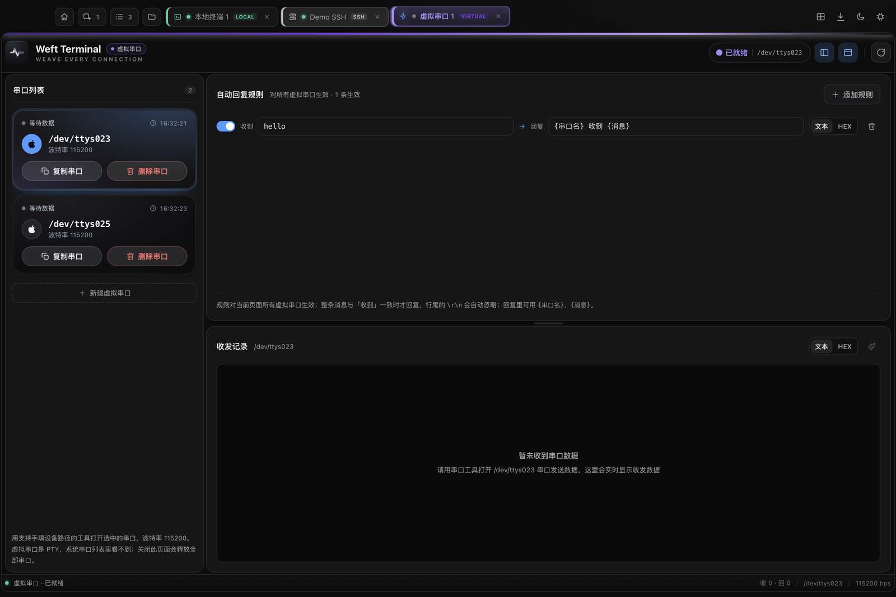

# Weft Terminal

**WEAVE EVERY CONNECTION** — 串口调试工具 · 本地终端 · SSH终端 · 虚拟串口，工作台，绿色安全，连接数据本地化处理。



## 功能

- **串口工具**：端口、波特率、校验位、停止位、流控；HEX / ASCII / UTF-8 / GBK 收发，时间戳、自动换行、日志保存、串口指令库与批量发送。
- **本地终端 / SSH 终端**：多标签、命令补全、历史记录；SSH 支持密码、私钥、SSH Agent 认证，以及 SFTP 文件传输。
- **虚拟串口**：一个页面可创建多对虚拟串口；自动回复规则支持整条消息匹配和 `{串口名}`、`{消息}` 模板，端口与规则随页面保存。
- **工作台**：标签按类型分组，可自定义标签配色与卡片背景，亮/暗主题，串口、终端、虚拟口统一管理。

## 界面预览

### 串口工具

端口参数、HEX / ASCII / UTF-8 / GBK 收发、时间戳、指令库与批量发送。



### 本地终端

多标签 Shell、命令补全、历史记录，配色跟随应用主题。


### SSH 终端

密码 / 私钥 / SSH Agent 认证，连接后可打开远程文件管理（SFTP）。



### 虚拟串口

一个页面可创建多对虚拟串口，自动回复支持 `{串口名}`、`{消息}` 模板。



## 技术栈

Electron · React 18 · Vite · xterm.js · node-pty · serialport · ssh2

## 开发

```bash
npm install
npm run dev
```

## 构建

```bash
npm run build     # 构建渲染进程
npm start         # 构建后启动 Electron
npm run dist      # 打包安装包（macOS dmg / Windows nsis）
```

## 平台说明

- macOS 的虚拟串口是 PTY（`/dev/ttysXXX`），不会被系统串口枚举列出，需要在第三方工具里手动填写路径。
- Windows 的虚拟串口依赖 [com0com](https://sourceforge.net/projects/com0com/) 生成 COM 端口对。

## 数据目录

应用数据目录为 `Weft Terminal`（macOS 下是 `~/Library/Application Support/Weft Terminal`）。
